# The photographers

Every wallpaper in this theme exists because someone stood in a particular place in Nigeria, at a particular moment, and took the picture. This page is for the 17 photographers behind these 20 images.

Their names also appear on your desktop and lock screen whenever their photograph is showing. Click the name on the desktop to visit their profile. If you enjoy one of these photographs, go and look at the rest of their work.

The images on this page are the wallpapers themselves, from `backgrounds/`: the photographers' originals, unchanged except where a section says it was cropped.

**Photographers:** Abduljalil Attahir, Abdulrahman Abubakar, Ahbee Photography, Barnabas Sani, Ben Iwara, Blessing Niniola, Deen Docs, Kureng Workx, Laminartosin, LekePOV, Mukhtar Shuaib Mukhtar, Paul Uchechukwu, PIXPECTIV, Sani Maikatanga, Shurhabil Bukhari, Stuffedbox NG, Tosin James

---

## Obudu Plateau, Cross River State

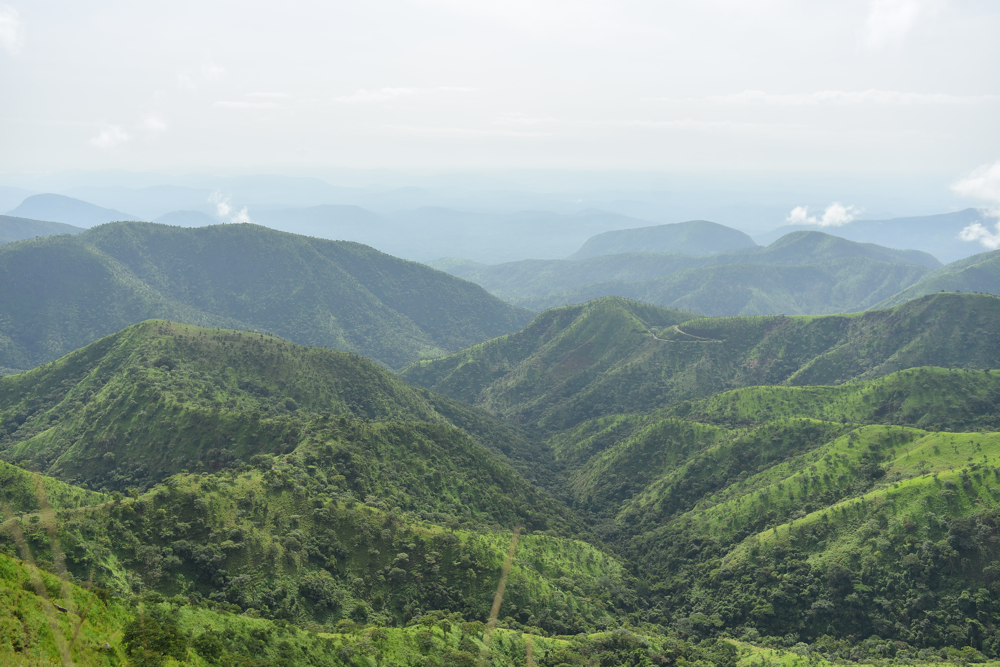

**Laminartosin** · [see more of their work](https://commons.wikimedia.org/wiki/Special:ListFiles/Laminartosin)

Ridge after ridge of green mountains on the plateau near the Cameroon border, taken on 16 June 2018.

`backgrounds/01-obudu-plateau-by-laminartosin.jpg` · 6016 × 4016 · [source](https://commons.wikimedia.org/wiki/File:OBUDU_MOUNTAINS_3.jpg) · [CC BY-SA 4.0](https://creativecommons.org/licenses/by-sa/4.0/)

---

## National Theatre, Lagos

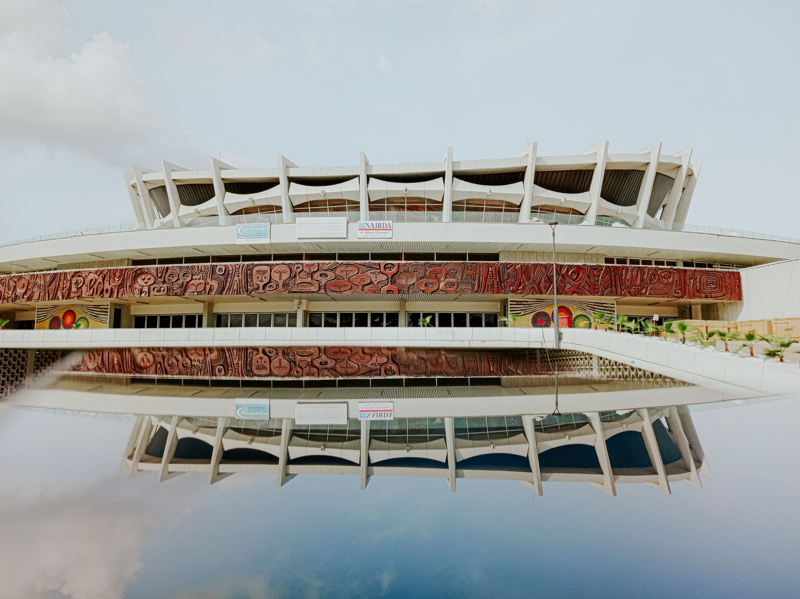

**Paul Uchechukwu** · [see more of their work](https://www.pexels.com/@paul-uchechukwu-246994638/)

Completed in 1976 for FESTAC '77 and often compared to a military cap, reflected in still water so the building appears twice.

`backgrounds/02-national-theatre-lagos-by-paul-uchechukwu.jpg` · 4585 × 3438 · [source](https://www.pexels.com/photo/38327849/) · [Pexels License](https://www.pexels.com/license/)

---

## A rocky pass at sunrise

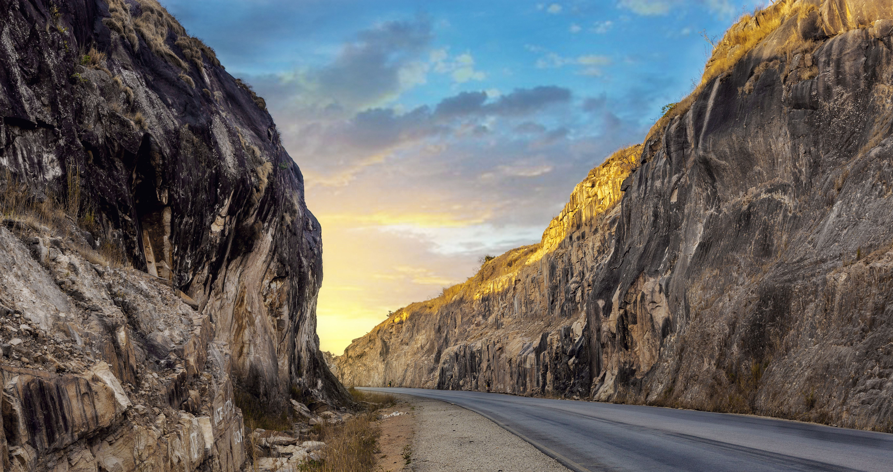

**Kureng Workx** · [see more of their work](https://www.pexels.com/@kureng-workx-2546437/)

A road threading between towering rock walls as the sun comes up.

`backgrounds/03-rocky-pass-at-sunrise-by-kureng-workx.jpg` · 5472 × 2895 · [source](https://www.pexels.com/photo/4405389/) · [Pexels License](https://www.pexels.com/license/)

---

## Carter Bridge, Lagos

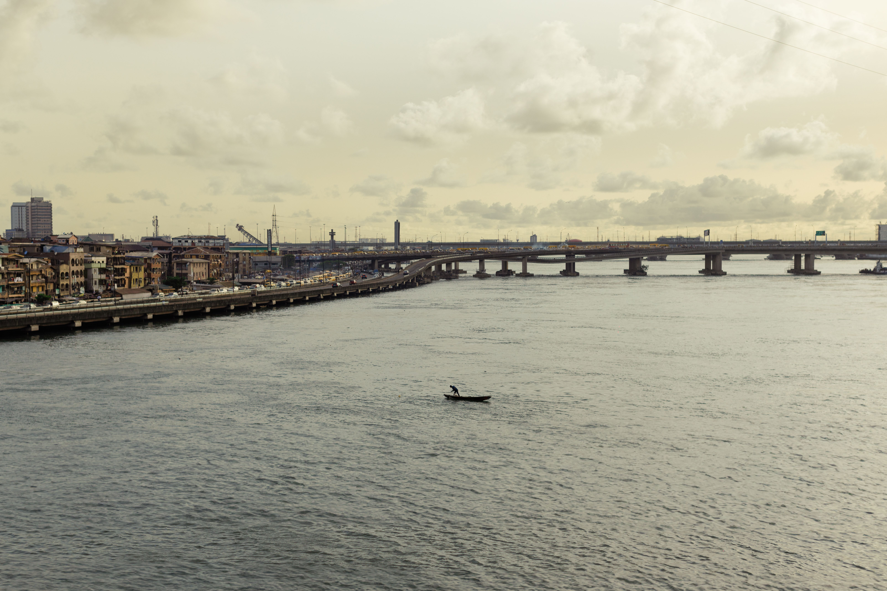

**Ben Iwara** · [see more of their work](https://www.pexels.com/@ben-iwara-1033992193/)

Carter Bridge stretching across the lagoon between Lagos Island and the mainland, with a lone boat below.

`backgrounds/04-carter-bridge-lagos-by-ben-iwara.jpg` · 6415 × 4277 · [source](https://www.pexels.com/photo/22681398/) · [Pexels License](https://www.pexels.com/license/)

---

## National Mosque, Abuja

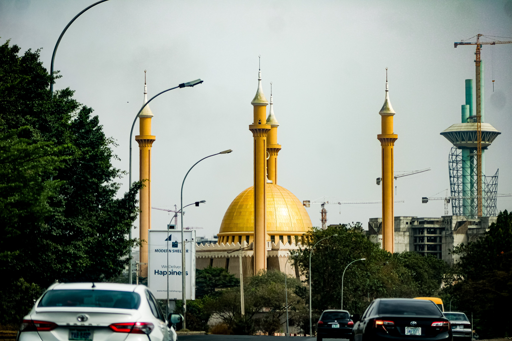

**Blessing Niniola** · [see more of their work](https://www.pexels.com/@blessing-niniola-650496724/)

The golden dome and four minarets of the National Mosque rising over an Abuja street.

`backgrounds/05-national-mosque-abuja-by-blessing-niniola.jpg` · 6000 × 4000 · [source](https://www.pexels.com/photo/20453360/) · [Pexels License](https://www.pexels.com/license/)

---

## Emir's Palace, Dutse

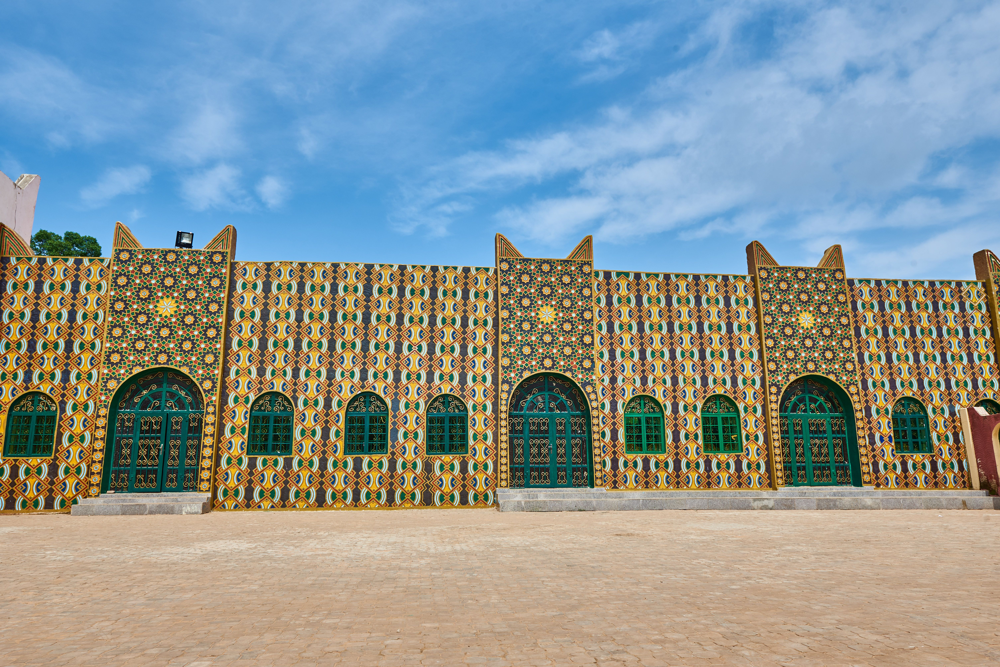

**Sani Maikatanga** · [see more of their work](https://www.pexels.com/@sanimaikatanga/)

The patterned green and gold facade of the Emir's Palace in Dutse, Jigawa State.

`backgrounds/06-emirs-palace-dutse-by-sani-maikatanga.jpg` · 6016 × 4016 · [source](https://www.pexels.com/photo/38192538/) · [Pexels License](https://www.pexels.com/license/)

---

## Lagos coastline from above

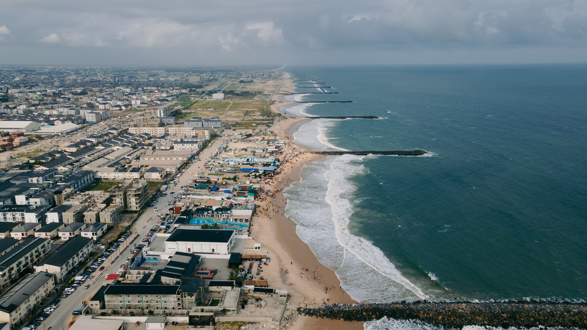

**Ben Iwara** · [see more of their work](https://www.pexels.com/@ben-iwara-1033992193/)

Atlantic surf breaking along the Lagos shoreline, seen from the air.

`backgrounds/07-lagos-coastline-by-ben-iwara.jpg` · 3938 × 2215 · [source](https://www.pexels.com/photo/27857461/) · [Pexels License](https://www.pexels.com/license/)

---

## Zuma Rock, Niger State

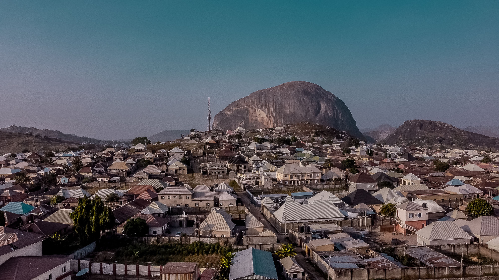

**Mukhtar Shuaib Mukhtar** · [see more of their work](https://www.pexels.com/@akoonie/)

The great granite monolith on the ₦100 note, standing over the rooftops of the town beneath it.

`backgrounds/08-zuma-rock-at-dusk-by-mukhtar-shuaib-mukhtar.jpg` · 4000 × 2250 · [source](https://www.pexels.com/photo/29539887/) · [Pexels License](https://www.pexels.com/license/)

---

## Civic Centre Towers, Lagos

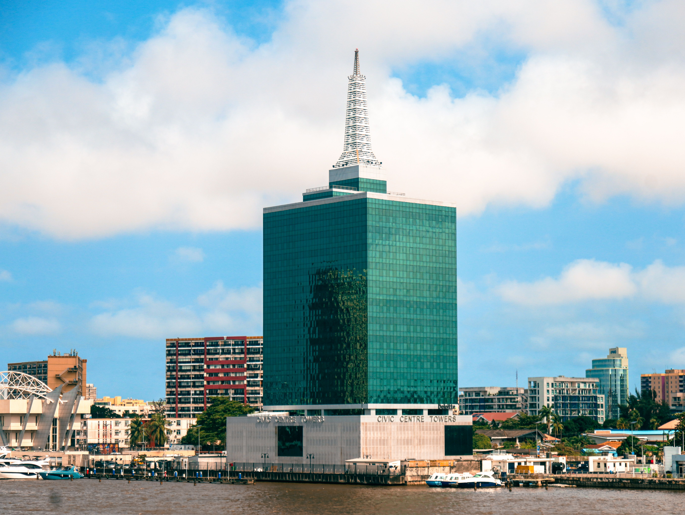

**Paul Uchechukwu** · [see more of their work](https://www.pexels.com/@paul-uchechukwu-246994638/)

The green-glass Civic Centre Towers rising above the Lagos waterfront under a broken sky.

`backgrounds/09-civic-centre-lagos-by-paul-uchechukwu.jpg` · 5536 × 4160 · [source](https://www.pexels.com/photo/40825499/) · [Pexels License](https://www.pexels.com/license/)

---

## Abuja City Gate

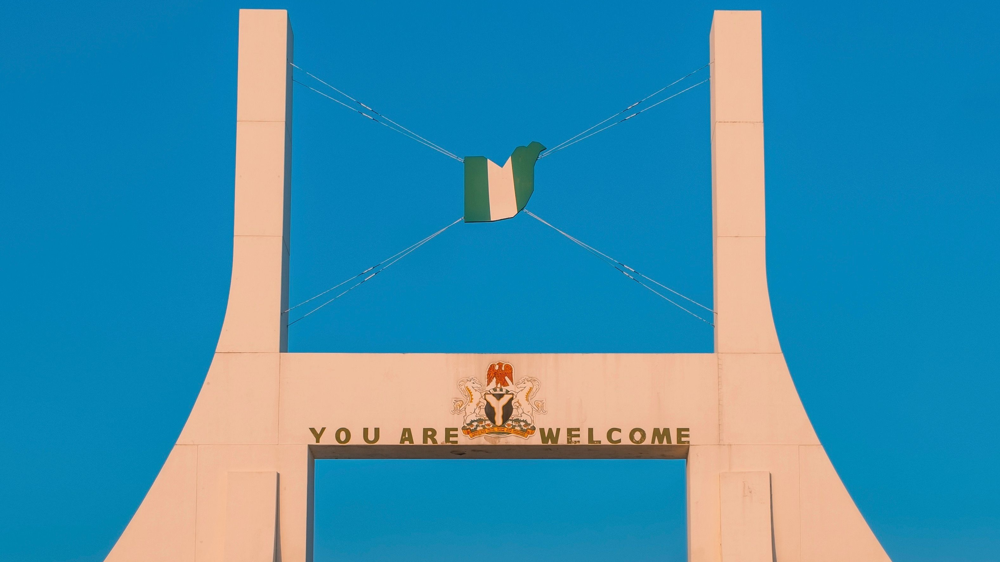

**Stuffedbox NG** · [see more of their work](https://www.pexels.com/@stuffedbox-ng-513424808/)

The city gate on the road into Abuja: two white pillars holding a green-white-green map of Nigeria, above the coat of arms and the words "You are welcome". Cropped from the portrait original to fit a landscape screen.

`backgrounds/10-abuja-city-gate-by-stuffedbox-ng.jpg` · 3153 × 1773 (cropped from 3153 × 5606) · [source](https://www.pexels.com/photo/16237519/) · [Pexels License](https://www.pexels.com/license/)

---

## Rocks and water, Bauchi

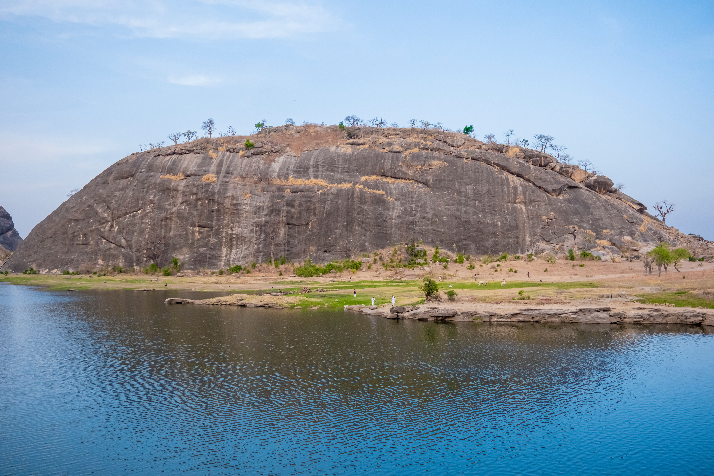

**Ahbee Photography** · [see more of their work](https://www.pexels.com/@ahbee-photography-463652994/)

A great dome of rock above clear water in Bauchi State.

`backgrounds/11-bauchi-rocks-and-water-by-ahbee-photography.jpg` · 7728 × 5152 · [source](https://www.pexels.com/photo/31580556/) · [Pexels License](https://www.pexels.com/license/)

---

## Coronation Hall gate, Kano

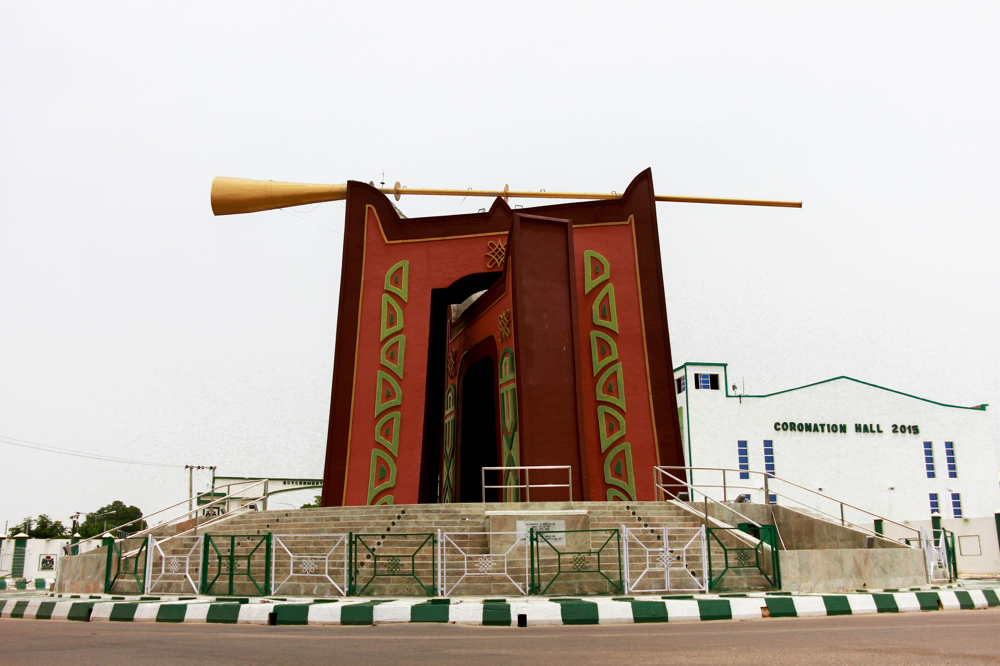

**Sani Maikatanga** · [see more of their work](https://www.pexels.com/@sanimaikatanga/)

The sculpted gate at Coronation Hall, a Kano landmark, crowned with long trumpets.

`backgrounds/12-coronation-hall-kano-by-sani-maikatanga.jpg` · 5184 × 3456 · [source](https://www.pexels.com/photo/38192304/) · [Pexels License](https://www.pexels.com/license/)

---

## Riverbanks, Port Harcourt

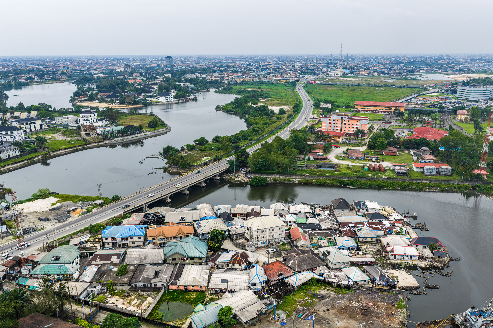

**PIXPECTIV** · [see more of their work](https://www.pexels.com/@pixpectiv-633410537/)

Creeks winding through Port Harcourt, with a bridge and rooftops at the water's edge.

`backgrounds/13-port-harcourt-riverbanks-by-pixpectiv.jpg` · 4500 × 3000 · [source](https://www.pexels.com/photo/34821017/) · [Pexels License](https://www.pexels.com/license/)

---

## Ngel Nyaki, Taraba State

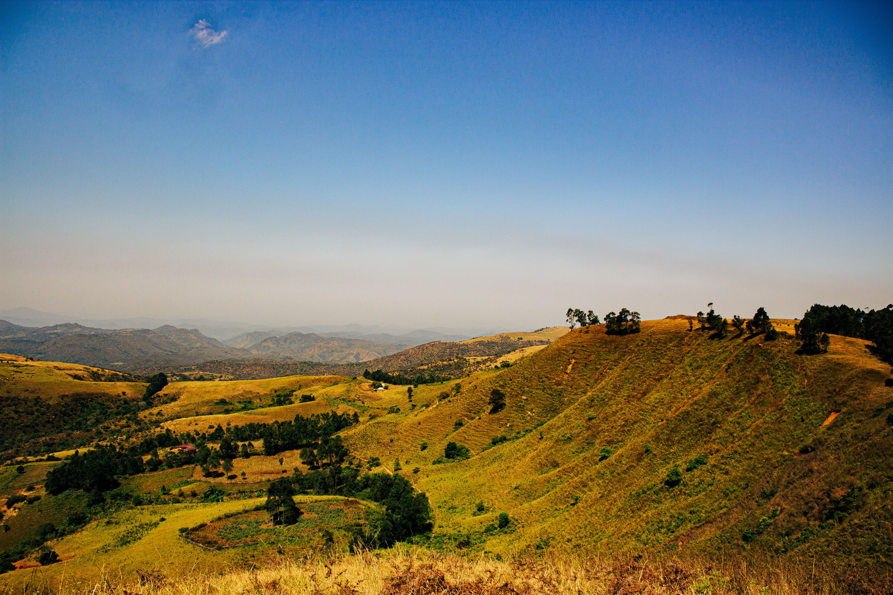

**Barnabas Sani** · [see more of their work](https://www.pexels.com/@barrytheoctopus/)

Rolling golden-green hills around Ngel Nyaki on the Mambilla Plateau.

`backgrounds/14-ngel-nyaki-hills-by-barnabas-sani.jpg` · 5184 × 3456 · [source](https://www.pexels.com/photo/34922944/) · [Pexels License](https://www.pexels.com/license/)

---

## Gidan Makama, Kano

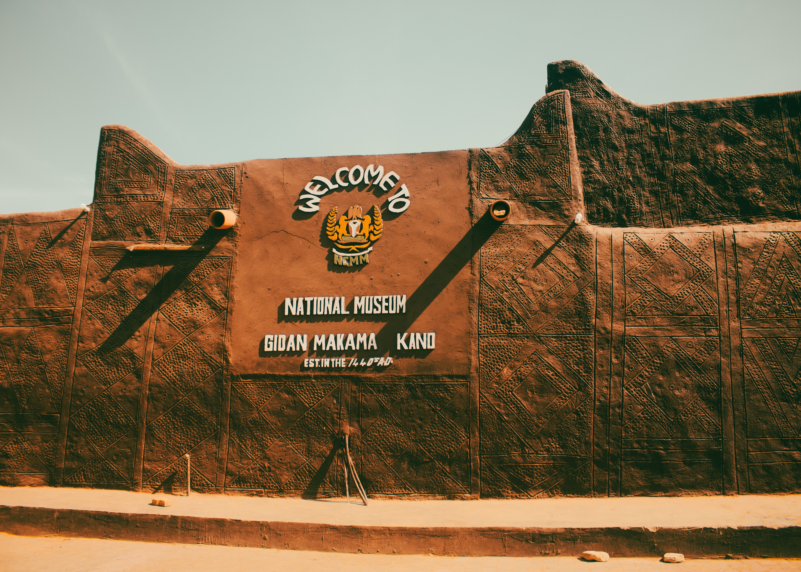

**LekePOV** · [see more of their work](https://www.pexels.com/@lekepov-2044219506/)

A centuries-old palace that now houses the National Museum, its carved earthen walls a fine example of Hausa architecture.

`backgrounds/15-gidan-makama-kano-by-lekepov.jpg` · 4838 × 3456 · [source](https://www.pexels.com/photo/36465063/) · [Pexels License](https://www.pexels.com/license/)

---

## Central Mosque, Kaduna

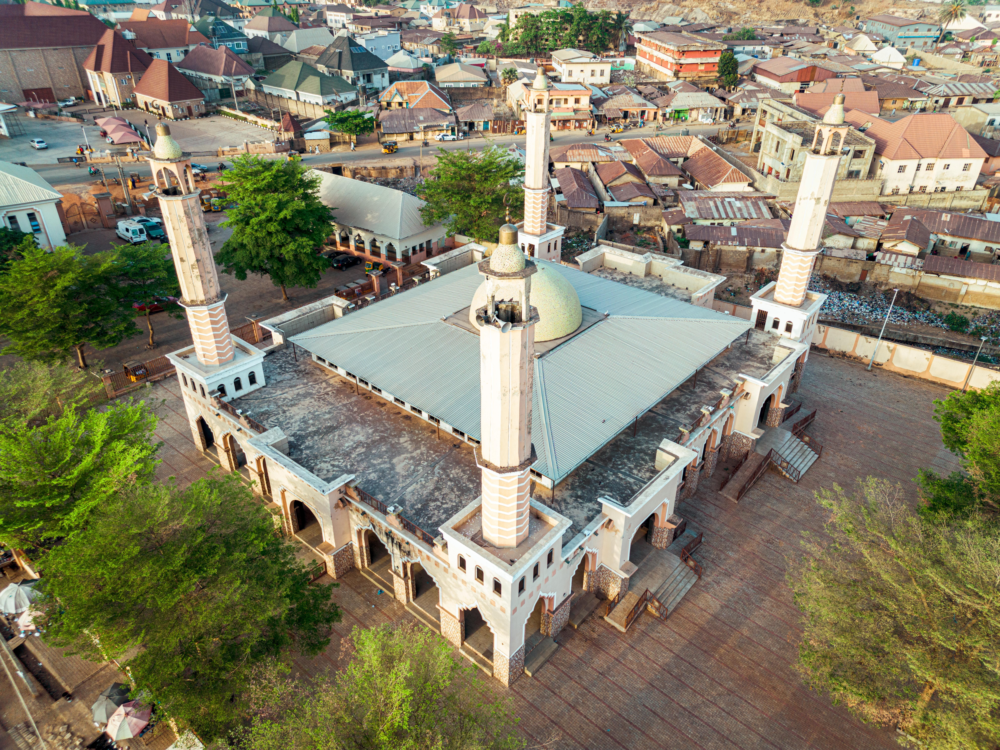

**Abdulrahman Abubakar** · [see more of their work](https://www.pexels.com/@abdulrahman-abubakar-501847670/)

Four white minarets and a green roof among the trees and streets of Kaduna, seen from the air.

`backgrounds/16-kaduna-mosque-from-above-by-abdulrahman-abubakar.jpg` · 8064 × 6048 · [source](https://www.pexels.com/photo/31619957/) · [Pexels License](https://www.pexels.com/license/)

---

## A waterfall in Kaduna

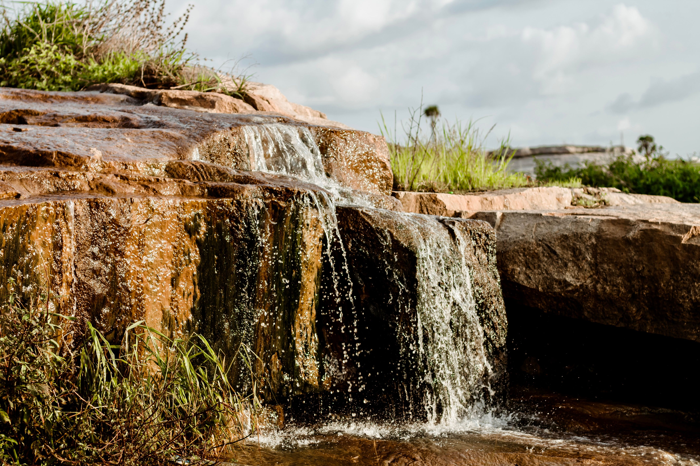

**Shurhabil Bukhari** · [see more of their work](https://www.pexels.com/@shurhabil-bukhari-279975050/)

Water cascading over warm-coloured rock, framed by grass, in Kaduna State.

`backgrounds/17-kaduna-waterfall-by-shurhabil-bukhari.jpg` · 4272 × 2848 · [source](https://www.pexels.com/photo/38602499/) · [Pexels License](https://www.pexels.com/license/)

---

## Savannah and hills

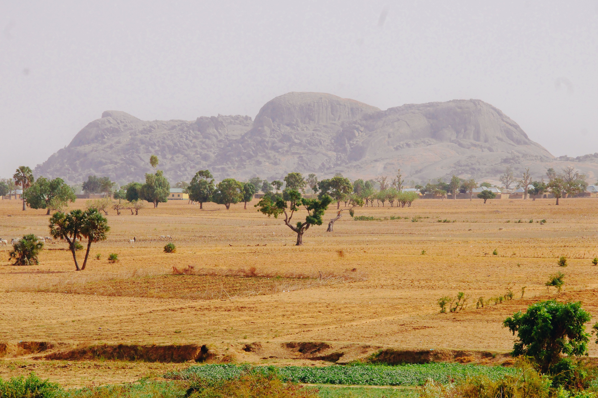

**Abduljalil Attahir** · [see more of their work](https://www.pexels.com/@abduljalil-attahir-2151751712/)

Golden Nigerian savannah dotted with trees, with hills rising in the haze beyond.

`backgrounds/18-savannah-and-hills-by-abduljalil-attahir.jpg` · 5891 × 3927 · [source](https://www.pexels.com/photo/31837575/) · [Pexels License](https://www.pexels.com/license/)

---

## A palm-lined beach, Lagos

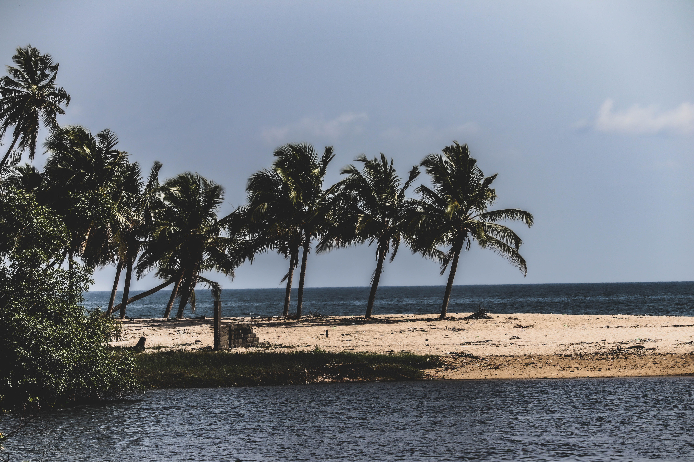

**Tosin James** · [see more of their work](https://www.pexels.com/@tosinjames/)

Palm trees leaning over a quiet stretch of Lagos shoreline.

`backgrounds/19-lagos-palm-beach-by-tosin-james.jpg` · 6000 × 4000 · [source](https://www.pexels.com/photo/5727646/) · [Pexels License](https://www.pexels.com/license/)

---

## A stadium from above

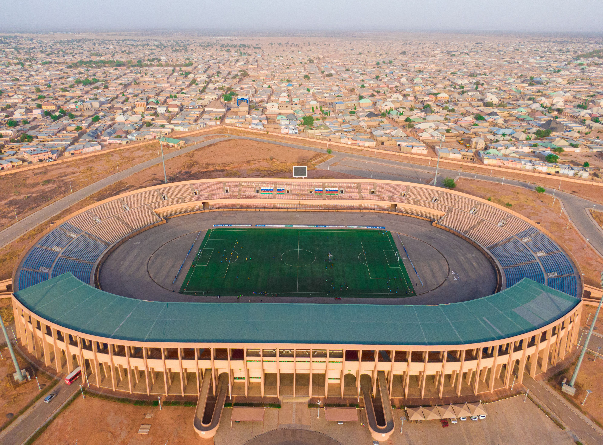

**Deen Docs** · [see more of their work](https://www.pexels.com/@deen-docs-2151173653/)

A football stadium's green pitch and bowl of stands, set in the surrounding city.

`backgrounds/20-stadium-from-above-by-deen-docs.jpg` · 3987 × 2949 · [source](https://www.pexels.com/photo/31606085/) · [Pexels License](https://www.pexels.com/license/)

---

## Using and sharing these photographs

- **Pexels photographs** are under the [Pexels License](https://www.pexels.com/license/): free to use and modify. Credit is not required, but we give it gladly. The licence does not allow selling unaltered copies, or putting the photos on other stock-photo or wallpaper platforms.
- **Wikimedia Commons photographs** are under Creative Commons BY-SA. When you share them, keep the photographer's name, the source link and the licence link. If you change one, say what you changed and share it under the same licence.
- None of the photographers is represented as endorsing this theme.

## Add your photograph

Have a photograph of a Nigerian place you love? Contributions are welcome. Please send a landscape original of at least 3840 × 2160, the place, when you took it, how you would like to be credited, a link to your work, and a licence that allows redistribution. Your photo will get its own section on this page, and your name on every desktop that shows it.
