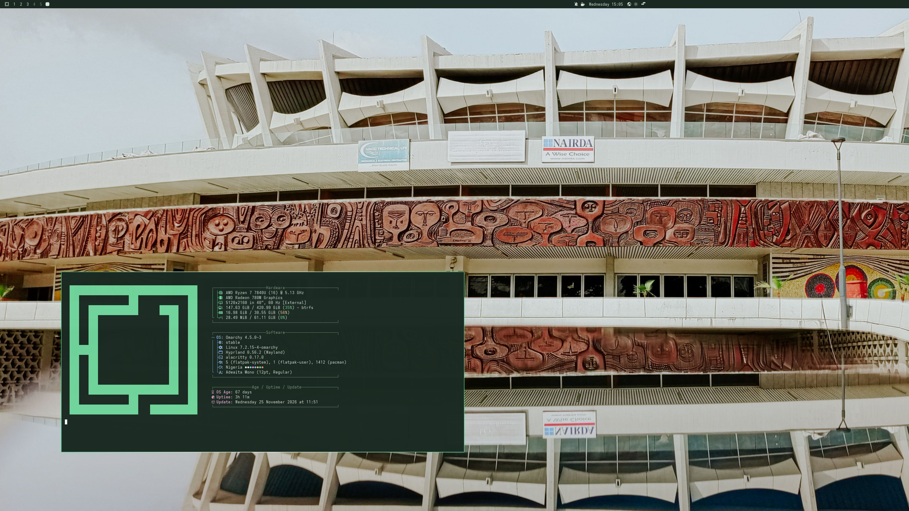
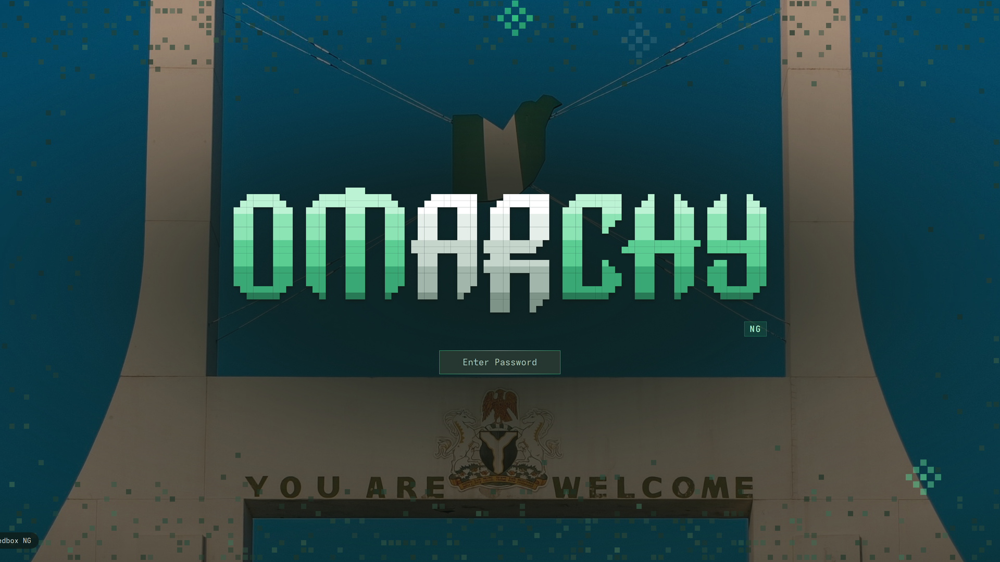

# Omarchy Nigeria

An Omarchy theme in Nigeria's green and white, with 20 high-resolution photographs of Nigerian places, each credited to the person who took it. Designed for a blog-led release around 1 October.



## Install

```bash
omarchy theme install <repository-url>
```

This installs and applies the theme as `nigeria`. To work from a local copy of this repository instead:

```bash
mkdir -p ~/.config/omarchy/themes
cp -r -n . ~/.config/omarchy/themes/nigeria
omarchy theme set nigeria
```

Use a fresh destination for the first local install. For the lock screen, the desktop photo credit and wallpaper rotation, see [Extras](#extras).

## Design

Soft green surfaces (`#1A2A22`), off-white text (`#DCE7DF`), and emerald accents (`#39D98A`). The terminal palette follows Everforest's approach to long reading sessions: a softened base, body text around 12:1 rather than a glaring pure white, and distinct hues at similar brightness, so errors, warnings, strings and comments stay easy to tell apart. Focused windows get an emerald / white / emerald border, like the flag; unfocused borders almost disappear.

The theme also ships its own bar, launcher, notification and lock-screen colours (`shell.toml`) and the green Yaru icon set. Omarchy builds a matching Claude Code theme from the palette; pick **Omarchy** with `/theme` in Claude Code. These are design choices inspired by the flag, not a claim about official colour specifications.

## Wallpapers

Twenty photographs, nineteen of them 4K or larger: the National Theatre, Carter Bridge, the Civic Centre and the coastline in Lagos; the National Mosque and the City Gate in Abuja; Zuma Rock at dusk; the Obudu Plateau and the hills of Ngel Nyaki; the Emir's Palace in Dutse; Gidan Makama and Coronation Hall in Kano; the creeks of Port Harcourt; mosques, waterfalls and savannah in the north; and more.

**[Meet the photographers](CREDITS.md).** Each has a section with their name, a link to more of their work, and the story of the place. Their names also appear on the desktop and lock screen whenever their photograph is showing, and each file is named after its photographer, so `omarchy theme bg current` tells you whose picture you are looking at.

The Abuja City Gate is cropped from a portrait original, 3153 pixels wide, so it looks softer than the rest on screens wider than that. Depending on your monitor's shape, the very wide photographs may lose a little at the sides and the 3:2 and 4:3 ones a little at the top and bottom.

To add a photograph: put a 4K landscape original in `backgrounds/` as `NN-place-by-photographer.jpg`, add its entry to [credits.json](credits.json), and run `python3 extras/build-credits.py` to rebuild the credits page.

## Extras



Three optional extras, installed together:

- **Lock screen.** In the style of the omarchy.org homepage: the current wallpaper, sharp and lightly graded toward the theme's greens, with the Omarchy pixel wordmark set straight into it in green, white and green, an **NG** badge, and a compact password field in the proportions of the site's buttons. Dim pixels sit around the edges, with small clusters twinkling on and off as they do on the site. The photographer is credited in the corner. Only the lock's visuals change: it is a fresh clone of Omarchy's current lock plugin, and password checking, failure messages and fingerprint support are untouched. The styling switches on only while the active theme ships `lock-emblem.svg`, so other themes keep the stock lock screen.
- **Desktop photo credit.** A small pill in the bottom-left corner of the desktop, behind your windows, naming the place and photographer of the current wallpaper. Click it to open the photographer's profile. It reads `credits.json` from the active theme and shows nothing for themes without one.
- **Random rotation.** Every 15 minutes the wallpaper changes to a random photograph from the set, never the one already showing. It runs only while a theme with `credits.json` is active.

Install them from this repository, while unlocked:

```bash
bash extras/install-local.sh            # or --replace if you already have a custom lock clone
```

This backs up your shell settings, clones and restyles the lock, installs the photo credit plugin and the rotation timer, and restarts the shell. `omarchy theme install` does not run it. It needs the Omarchy shell plugin system, Python 3, and systemd user services.

Preview the lock screen without locking (click to dismiss):

```bash
omarchy-shell lock preview
```

Pause or resume rotation:

```bash
systemctl --user stop nigeria-city-rotation.timer
systemctl --user start nigeria-city-rotation.timer
```

To change the interval, run `systemctl --user edit nigeria-city-rotation.timer` and add:

```ini
[Timer]
OnUnitActiveSec=
OnUnitActiveSec=30min
```

Then run `systemctl --user daemon-reload` and `systemctl --user restart nigeria-city-rotation.timer`.

To undo the extras:

- **Rotation:** `systemctl --user disable --now nigeria-city-rotation.timer`.
- **Photo credit:** `omarchy plugin disable nigeria.photo-credit`.
- **Lock screen:** `omarchy plugin disable "$USER.lock"`, then `omarchy restart shell` while unlocked. When Omarchy updates its lock, re-run the installer with `--replace` to pick up the new version.

The lock artwork is generated by `extras/make-lock-art.py`.

## Nigeria 66 identity

The anniversary artwork for 66 years of independence (1 October 2026) is in [identity/nigeria-66.svg](identity/nigeria-66.svg), ready for the blog and release graphics.

## Project status

Reading-tuned palette, flag-style focus borders, shell styling, 20 credited high-resolution wallpapers, random rotation, the desktop photo credit, and the Omarchy Nigeria lock screen. The lock has been checked in preview on a 5K display; a real lock and unlock with password and fingerprint still needs checking before public release. See [the brief](docs/brief.md) and [blog draft](docs/blog-draft.md).

## Licence

The theme configuration, scripts and documentation are released under the MIT licence ([LICENSE](LICENSE)). The photographs keep their own licences, listed in [CREDITS.md](CREDITS.md).
